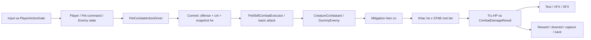

# Gameplay va chin he

## Pham vi va nguon du lieu

Dot 2026-11-17 tach refactor giu hanh vi khoi thay doi khac he/STAB. Scene kiem la `DemoScene 1`; khong sua scene `DemoScene` goc. Khong doi cong thuc tam stat, crit, phong thu, power, cooldown, AI, loot, capture, inventory hay save format v14. MP van bi retire; `manaCost` va `startingMana` cu chi con la du lieu tuong thich.

`Assets/Game/Elements/ElementCatalog.cs` la nguon duy nhat cho chin he, thu tu, ten, icon va palette. Thu tu hien thi tach khoi so enum. `PetElement` va `CodexType` giu nguyen so cu; `CodexElementAdapter` map bang switch, khong cast so hoac parse ten chuoi.

Bang authoring duy nhat: `Assets/Game/Elements/Resources/Combat/ElementMatchups.asset`. Sua trong Inspector; `OnValidate` tao lai lookup 81 o mot lan. Cac cap khong khai bao la x1. Khong tu suy quan he nguoc. Validator tu choi he ngoai danh muc, hang/cap trung, cap vua manh vua yeu. Bang sai se trung tinh toan bang va bao loi trong Editor/Development; khong lay mot nua cau hinh sai de tinh damage.

## Phan trach nhiem

| Vung | Thanh phan | Trach nhiem va gioi han |
|---|---|---|
| Player | `BasicPlayerMovement` | Doc input, quyen hanh dong, chuyen state, dieu phoi di chuyen; giu component/GUID/field serialize cu |
| Player | `.Animation`, `.Grounding`, `PlayerLocomotionMath` | Binding Animator, grounding/collider, phep tinh locomotion; khong so huu input hay combat |
| Pet | `PetCommandInput`, `PetSummonDirector` | Lenh, active pet, luong summon/recall va xac nhan doi pet |
| Pet | `PetController` | Façade va state; `.Navigation` quan ly agent/di chuyen, `.Presence` quan ly collider/visual/summon |
| Enemy | `BasicCreatureEnemy` | Quyet dinh tra dua, target, state va lua chon don; khong tu tinh damage |
| Navigation | `EnemyNavigationAgent` | Cache path, repath, NavMesh, stuck/recovery; khong quyet dinh phe dich hay animation |
| Du lieu | `PetCollectionMetadata`, `PetHudRuntimeStats`, `PetStatCalculator` | Identity/form/he/stat, HP/loadout/cooldown; khong them ban sao runtime phai dong bo |
| Skill | `PetSkillDefinition`, `PetSpeciesSkillSet` | Definition chung, learnset, animation/VFX/SFX override theo loai |
| Skill | `PetCombatActionDriver` | Commit, buffer, release marker, recovery, cancel va cooldown qua callback cu |
| Skill | `PetSkillCombatExecutor` | Snapshot offense/crit/he, chia budget volley, projectile/melee va va cham that |
| Presentation | `PetSkillPresentationPlayer`, pool, feedback | Animation/VFX/SFX va damage text; khong roll lai damage |
| Receiver | `CreatureCombatant`, `DummyEnemy` | Xac thuc hit, mitigation cu, mot lan STAB/khac he, tru HP, phat HP mat that |
| Lifecycle | Encounter/capture/reward/save hien co | Downed, bat, respawn, thuong va giao dich save; khong thay bang he song song |

Partial chi to chuc nhom workflow cua cung component; field serialize van o file goc. Navigation Enemy duoc tach thanh lop thuan co trach nhiem rieng, khong them MonoBehaviour. `CreatureCombatRules` giu nguyen public API va cong thuc, chi tach ra file rieng. Khong xoa fallback hay `DummyEnemy`.

## Hop dong damage

- `CombatHit.RawDamage` luon truoc mitigation va truoc he so he.
- Overload cu khong cung cap `CombatElementSnapshot` van trung tinh, ke ca ID la `basic`.
- Don thuong chu dong chup he Normal khi bat dau don. Skill chup he skill va hai he nguon o callback commit, dung chung snapshot cho moi phat.
- Receiver doc he muc tieu tai hit hop le. Hai he muc tieu trung nhau chi tinh mot lan. Nguon trung he chinh/phu chi nhan STAB x1.5 mot lan.
- Khong clamp he so: Fire STAB danh Nature/Dark la x6; Fire danh Water/Dragon la x0.25 truoc STAB.
- Bleed bo qua he so moi, giu ba nhip, refresh va lifetime cu. Buff/heal khong di qua damage receiver.
- Loai vat ly/phep doc lap he. Crit va raw budget volley giu nguyen. HP mat that sau phong thu/he so moi la nguon cho text va reward.
- Khong co metadata thi khong tu tao Normal/STAB. Unknown/legacy/so enum la khong hop le se trung tinh cho phan he do.

## Mapping theo skill ID

| ID giu nguyen | Truoc | Hien tai | Ly do |
|---|---|---|---|
| `bite` | Nature | Normal | Don can thuong theo yeu cau |
| `blast` | Light | Normal | Gam buff, van khong gay damage |
| `projectile` | Fire | Fire | Giu cau hinh da co; khong suy tu VFX |
| `wing strike` | Wind | Flying | Don canh/chem gio da duoc xac dinh |
| `bite.normal` | Normal | Normal | Definition da phu hop |
| `orb.dark` | Dark | Dark | Definition da phu hop |
| `pulse.dark` | Dark | Dark | Definition da phu hop |

`SkillElementAssignments` chi chua bon ID duoc duyet. Definition, cache skill cu, default/fallback, generator va load adapter cung dung mapping. Khong doi ID co khoang trang. Ban cache serialize trong 25 asset duoc doi dung field element; file GUID va cac gia tri khac duoc doi chieu voi backup.

Raw Wind/Earth/Ice/Light/Mythic khac khong bi map hang loat. UI hien `Chua phan loai` qua catalog; raw save/asset duoc giu de tac gia phan loai. Audit task luu danh sach tung file/ID can xem, khong tu sua save that.

## Them noi dung

1. Loai/form: tao/sua family va form hien co, tham chieu visual/pet/wild/enemy prefab, stat profile va skill set. He cua actor duoc author tren `PetCollectionMetadata` cua prefab, he tien hoa tren rule cu. Chon mot he chinh va toi da mot he phu; khong doi definitionId/formId da dung.
2. Skill: tao `PetSkillDefinition` co ID on dinh, he thuoc chin muc. Chon combat profile rieng cho power/delivery/damage kind; UI metadata chi mo ta. Them vao catalog va species learnset/default loadout. Dung animation profile va presentation override neu tung loai can clip/VFX/SFX rieng.
3. Khong them skill moi vao mapping bon ID cu. Noi dung moi doc truc tiep element authoring. Them alias vao `legacyIds` khi can, khong doi ID trong save.
4. Inspector chi cho chon chin he moi; he phu co Unknown. Du lieu legacy duoc hien raw de giu nguyen, khong tu doi khi mo Inspector. `ValidateCatalog` bao skill chua phan loai. Bang khac che co validator rieng.
5. Chinh bang he: sua asset `ElementMatchups`, sau do chay Tools > Capstone > Advanced > Gameplay Cleanup > 5. Neu chu dich doi bang fantasy nay, cap nhat expectation kiem thu va ghi ro thay doi gameplay.

Ly do bang fantasy: Lua dot Co/xua Toi; Nuoc dap Lua; Co hap thu Nuoc; Dien khac moi truong nuoc va muc tieu tren khong; Giac dau la ky thuat/y chi; Bay co loi the tam cao; Toi can quan sat/dinh huong; Rong doi dau Rong la quy uoc suc manh. Thuong uu tien on dinh. Day khong phai mo phong vat ly hay cam ket da can bang hoan chinh.

## Kiem chung va gioi han

Menu 1-4 la baseline/refactor; khong dung chung thu muc ket qua voi dot he. Menu 5 kiem contract/save; menu 6 dung receiver va skill that trong arena tam. Menu 7-9 kiem hoi quy sau he; menu 10 chay ba dot do co gioi han va dung neu bat ky dot nao loi. Khong menu nao tu chay sau import.

Menu 11 kiem cache authoring va save v1 thieu truong that, sau do chay lai contract hien tai. `ValidateCatalog` va `ValidateSet` chu dong lam moi cache de thay doi tren definition/learnset/alias duoc nhan ma khong can domain reload; `TryGet` runtime van dung cache. Neu sua danh sach bang code, goi `Invalidate` hoac lenh validate sau khi hoan tat sua.

Menu 12 tai su dung arena/save isolation cua verification cu, kiem dan dang bay, muc tieu ne/bi ha, tuong, recall, doi visual form, unload scene tam va callback tab skill/HUB o hai resolution. Ket qua followup nam trong thu muc con rieng; khong ghi de bang chung dot truoc. Kiem qua callback khong thay the ma tran thao tac phim/chuot thu cong toan game.

Bao cao, ledger, snapshot, CSV, log, fixture/save va anh runtime o `E:/UnityWork/CapstoneProjectData/Artifacts/gameplay-cleanup-elements-2026-11-17/`. Ket qua thuc chay va cac muc chua kiem chung duoc ghi trong bao cao tai do; khong suy ra da dat standalone, tat ca scene hay Profiler dai han tu compile.
